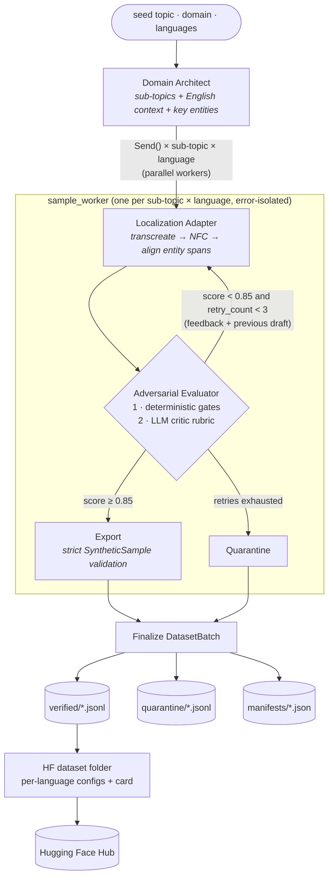

# PolyGlot-Crew: Synthetic Multilingual Data & Knowledge Generator

PolyGlot-Crew is a multi-agent pipeline built on **LangGraph** and **Pydantic v2**. It generates domain-specific NLP datasets (medical, legal, finance) in Indian languages and scripts, then checks every sample before it can be exported:

1. A **Domain Architect** expands a seed topic into sub-topics, each with a factual English source passage.
2. A **Localization Adapter** rewrites each passage for native readers of Hindi, Hinglish, Telugu, Tamil and other languages, adapting it rather than translating word for word.
3. An **Adversarial Evaluator** scores each candidate. Low scores go back to the adapter with feedback, up to 3 retries. A sample that still fails is quarantined.

Only samples that pass every gate become publishable `SyntheticSample` records with character-exact entity spans. These are written as JSONL and can be published directly as a Hugging Face dataset.

The pipeline is **model-agnostic**: each agent runs on the Claude API or on a local Ollama model (`llama3`, `mistral`, ...), and you can mix them per role.

---

## Architecture



### How each stage works

| Stage | What it does | Why it matters |
|---|---|---|
| **Domain Architect** | Uses structured output (`DomainBlueprint`) to produce N sub-topics, each in a different document format (dialogue, discharge note, SMS reminder, ...) with 4–8 labelled key entities. The output is then cleaned: key entities missing from the passage, labels outside the taxonomy and duplicate sub-topics are dropped. | Every sample is grounded in an explicit English source passage, so the critic has something to check drift and hallucination against. |
| **Localization Adapter** | Rewrites the passage for native readers using a per-language style guide (register, code-mixing norms, numerals). It returns entity **strings only**, never character offsets. | LLMs cannot count characters. Offsets are computed afterwards by code. |
| **Span alignment** (`src/linguistics.py`) | Normalizes text to NFC and finds every non-overlapping occurrence of each entity, longest match first, respecting word boundaries. For agglutinative languages (Telugu, Tamil, Kannada, Malayalam) a match may end mid-word so that inflected forms align. | `raw_text[start:end] == text` holds for every published entity. Repeated entities are all labelled, so the data does not teach NER models false negatives. |
| **Evaluator stage 1: rules** (no tokens spent) | Checks script purity (e.g. ≥ 60% Devanagari for Hindi, ≥ 95% Latin for Hinglish), that every entity occurs verbatim, the label taxonomy, key-entity coverage, and **numeric fidelity**: every number in the source must survive, compared across numeral systems so `२५` = `25`. | Catches the most damaging failures (a changed dose, wrong script, invented spans) without spending tokens. The feedback names the exact problem. |
| **Evaluator stage 2: LLM critic** | An adversarial rubric (`CriticVerdict`) scores `semantic_fidelity`, `factual_consistency`, `entity_retention` and `fluency`, then gives actionable feedback. | The final score is a weighted mean **capped at the weakest dimension** when that dimension is below `DIMENSION_FLOOR`, so good fluency cannot average away a hallucination. |
| **Routing** (`route_after_evaluation`) | `score ≥ 0.85` → export. Below that with `retry_count < 3` → back to the adapter with the critic's feedback and the rejected draft. Otherwise → quarantine. | This is the adversarial rejection loop. |
| **Export** | Builds a strict `SyntheticSample`. If validation fails, the sample is quarantined instead of crashing the run. | Strict schema validation is the last gate before data is published. |

**Fault isolation.** Each sample runs inside its own exception boundary. A provider outage or repeated schema-invalid output on one sample quarantines that sample (`reason: pipeline_error`), and the rest of the batch continues.

---

## Project structure

```
.
├── main.py                    # CLI: run a batch, print token/perf report, write JSONL, optional Hub push
├── requirements.txt
├── .env.example               # all configuration knobs, documented
├── pytest.ini
├── scripts/
│   └── publish_to_hub.py      # publish all verified batches as one HF dataset
├── src/
│   ├── config.py              # Settings (validated env config), per-role model routing, QualityGate
│   ├── llm.py                 # provider factory (Anthropic / Ollama), StructuredLLM: retries + self-correction
│   ├── telemetry.py           # thread-safe token & latency tracking
│   ├── linguistics.py         # NFC, script detection, numeral normalization, entity span alignment
│   ├── graph.py               # LangGraph workflows: fan-out/fan-in + localize⇄evaluate retry loop
│   ├── exporter.py            # atomic JSONL writer, manifests, HF dataset folder + card, Hub upload
│   ├── agents/
│   │   ├── nodes.py           # Domain Architect, Localization Adapter, Adversarial Evaluator, sinks
│   │   ├── prompts.py         # versionable prompt templates
│   │   └── state.py           # PipelineState / SampleState TypedDicts + internal models
│   └── schemas/
│       ├── dataset.py         # EntityLabel, SyntheticSample, DatasetBatch, QuarantinedSample, taxonomies
│       ├── agent_io.py        # structured-output contracts for each agent
│       └── languages.py       # language registry: BCP-47 tag, script, style guide, thresholds
└── tests/                     # 42 offline tests (scripted LLM fakes): schemas, alignment, graph routing, export
```

---

## Installation

Requires **Python 3.11+**.

```bash
git clone <your-fork-url> polyglot-crew && cd polyglot-crew
python3.12 -m venv .venv && source .venv/bin/activate
pip install -r requirements.txt
cp .env.example .env
```

---

## Running

### Option A: local models with Ollama (free, private)

```bash
# 1. Install Ollama (https://ollama.com) and pull a model
ollama pull llama3          # or: mistral, qwen2.5, gemma3 ...
ollama serve                # if it is not already running

# 2. Configure (.env)
LLM_PROVIDER=ollama
OLLAMA_MODEL=llama3
MAX_CONCURRENCY=1           # one local GPU: keep this at 1-2

# 3. Run
python main.py --seed-topic "Clinical Drug Dosage Diagnostics" --languages hindi hinglish telugu
```

> 7–8B local models are weak at Indic generation, and as judges they tend to be lenient. Expect a
> high quarantine rate and some false accepts. That is the gate doing its job. For better yield,
> keep generation local but judge with a stronger model (see mixed mode below).

### Option B: Claude API

```bash
# .env
LLM_PROVIDER=anthropic
ANTHROPIC_API_KEY=sk-ant-...
ANTHROPIC_MODEL=claude-sonnet-5-5   # any Claude model id works
MAX_CONCURRENCY=6

python main.py --domain medical --num-subtopics 5 --languages hindi hinglish telugu tamil
```

### Option C: mixed providers per role

Each agent role can use any `provider:model`, which lets you trade cost against quality. Using a *different* model as the critic also reduces self-preference bias.

```bash
# .env
LLM_PROVIDER=ollama
OLLAMA_MODEL=llama3
EVALUATOR_LLM=anthropic:claude-sonnet-5-5   # generate locally, judge with Claude
ANTHROPIC_API_KEY=sk-ant-...
```

### CLI reference

```text
python main.py [--seed-topic TEXT] [--domain {medical,legal,finance}]
               [--languages LANG [LANG ...]] [--num-subtopics N]
               [--provider {anthropic,ollama}] [--max-concurrency N]
               [--output-dir DIR] [--env-file PATH]
               [--push-to-hub [REPO_ID]] [--log-level LEVEL]
```

Languages (registry key or BCP-47 code): `hindi` (`hi`), `hinglish` (`hi-Latn`), `marathi`, `bengali`, `gujarati`, `punjabi`, `telugu`, `tamil`, `kannada`, `malayalam`.

Exit codes: `0` success · `1` configuration/input error · `2` pipeline failure (e.g. provider unreachable) · `130` interrupted.

### Example output

Each LLM call is logged with its tokens and latency, and the run ends with a report. This one comes from a real local run with `llama3`:

```text
[localizer] ollama:llama3 | hi | Optimizing Antihypertensive Therapy | attempt 1 | 517 in / 296 out tokens | 14.27s
[evaluator] ollama:llama3 | hi | Optimizing Antihypertensive Therapy | attempt 1 | 680 in / 255 out tokens | 13.49s
[evaluator] hi | Optimizing Antihypertensive Therapy | attempt 1 | score 0.830 (ollama:llama3)
[localizer] ollama:llama3 | hi | Optimizing Antihypertensive Therapy | attempt 2 | 939 in / 286 out tokens | 15.35s
...
==============================================================================
 PolyGlot-Crew run report  |  batch batch-8c27a998ac57
==============================================================================
 Seed topic : Clinical Drug Dosage Diagnostics  (medical)
 Samples    : 4 planned | 3 verified | 1 quarantined {'low_quality': 1}
 Acceptance : 75.0% overall | 25.0% first-pass | 1.0 mean retries (verified)
 Throughput : 212.06s wall | 1.13 samples/min
 LLM usage  : 16 calls (0 failed) | 10,427 in + 4,182 out tokens | 212.0s model time

 Usage by role:
     role         model  calls  failed  input_tokens  output_tokens  mean_latency_s  p95_latency_s
architect ollama:llama3      1       0           251            378           17.28          17.28
localizer ollama:llama3     10       0          6824           2408           12.18          15.07
evaluator ollama:llama3      5       0          3352           1396           14.58          21.95

 Quality by language:
language  samples  mean_score  min_score  mean_retries  mean_entities
      hi        2        0.85       0.85           0.5            4.5
 hi-Latn        1        0.87       0.87           2.0            4.0
```

In this run, 10 localizer calls needed only 5 critic calls: the deterministic gates rejected the other 5 drafts for free. One of them was a Hinglish draft that dropped the "3" from "3 times a day".

### Outputs

```
data/
├── verified/<batch_id>.jsonl     # publishable SyntheticSample records
├── quarantine/<batch_id>.jsonl   # rejected candidates with full feedback history (for error analysis)
└── manifests/<batch_id>.json     # batch metadata + run report (tokens, latency, acceptance)
```

A verified record (abridged; this one needed one retry):

```json
{
  "id": "pg-…",
  "target_language": "hi",
  "script": "Deva",
  "raw_text": "डॉक्टर ने आपके लिए मेटोप्रोलोल निर्धारित किया है … आपको 50mg दो बार दिन में लेना होगा अगले 4 हफ्तों के लिए …",
  "entities": [
    {"text": "मेटोप्रोलोल", "label": "DRUG", "start_char": 19, "end_char": 30},
    {"text": "50mg", "label": "DOSAGE", "start_char": 99, "end_char": 103},
    {"text": "दो बार दिन में", "label": "FREQUENCY", "start_char": 104, "end_char": 118},
    {"text": "4 हफ्तों के लिए", "label": "DURATION", "start_char": 134, "end_char": 149}
  ],
  "domain": "medical",
  "quality_score": 0.85,
  "feedback": "…critic remarks…",
  "quality_breakdown": {"semantic_fidelity": 0.8, "factual_consistency": 0.9, "entity_retention": 0.9,
                        "fluency": 0.8, "entity_coverage": 1.0, "script_ratio": 0.992},
  "provenance": {"seed_topic": "Clinical Drug Dosage Diagnostics", "subtopic": "Optimizing Antihypertensive Therapy",
                 "text_format": "patient counselling dialogue", "source_context": "…English source…",
                 "generator_model": "ollama:llama3", "evaluator_model": "ollama:llama3",
                 "retry_count": 1, "created_at": "2026-10-21T08:41:46Z"}
}
```

---

## Data schemas (`src/schemas/dataset.py`)

| Model | Fields | Guarantees |
|---|---|---|
| `EntityLabel` | `text, label, start_char, end_char` | `end > start`, `end − start == len(text)`, label is `UPPER_SNAKE` |
| `SyntheticSample` | `id, target_language, script, raw_text, entities, domain, quality_score, feedback` (+ `quality_breakdown`, `provenance`) | `raw_text` is NFC; every span matches `raw_text` exactly; spans sorted and non-overlapping; labels belong to the domain taxonomy; score ∈ [0, 1] |
| `DatasetBatch` | `batch_id, timestamp, total_samples, samples` (+ `seed_topic`, `domain`) | `total_samples == len(samples)`; unique ids; timezone-aware timestamp |
| `QuarantinedSample` | task info, `reason`, last draft, `feedback_history`, `error` | Lenient on purpose, so that every failure can still be recorded |

Entity taxonomies: **medical** `DRUG, DOSAGE, FREQUENCY, ROUTE, DURATION, CONDITION, SYMPTOM, LAB_TEST, BODY_PART, PROCEDURE, POPULATION` · **legal** `STATUTE, PROVISION, COURT, PARTY, LEGAL_ROLE, JURISDICTION, DATE, PENALTY, LEGAL_CONCEPT, CASE_REFERENCE, AUTHORITY` · **finance** `ORGANIZATION, FINANCIAL_INSTRUMENT, MONETARY_AMOUNT, PERCENTAGE, DATE, REGULATOR, FINANCIAL_METRIC, TAX_CONCEPT, ACCOUNT_TYPE, MARKET_INDEX`.

---

## Publishing to Hugging Face

1. Create a **write** token at <https://huggingface.co/settings/tokens> and set `HF_TOKEN` in `.env` (or run `hf auth login`).
2. Publish, using either option:

```bash
# Right after a run
python main.py --push-to-hub your-username/polyglot-medical-indic

# Or later: merge every batch in data/verified/ into one dataset
python scripts/publish_to_hub.py --repo-id your-username/polyglot-medical-indic
python scripts/publish_to_hub.py --dry-run        # build data/hf_dataset/ locally and inspect it first
```

The publisher re-validates every record, removes duplicate ids, and uploads this layout:

```
hf_dataset/
├── README.md                 # dataset card: YAML metadata, per-language configs, stats, limitations
└── data/<lang>/train.jsonl   # e.g. data/hi/, data/hi-Latn/, data/te/
```

Each publish is a **full snapshot**, so stale files on the Hub are removed. Repos are private unless `HF_PRIVATE=false` or `--public` is set. Consumers can then load the data with:

```python
from datasets import load_dataset

ds = load_dataset("your-username/polyglot-medical-indic", "all")    # every language
te = load_dataset("your-username/polyglot-medical-indic", "te")     # one language
```

---

## Configuration

Every option lives in `.env.example`. These are the main ones:

| Variable | Default | Purpose |
|---|---|---|
| `LLM_PROVIDER` | `ollama` | Default backend for all agents (`ollama` or `anthropic`) |
| `ANTHROPIC_MODEL` / `OLLAMA_MODEL` | `claude-sonnet-5-5` / `llama3` | Model per provider |
| `ARCHITECT_LLM`, `LOCALIZER_LLM`, `EVALUATOR_LLM` | unset | Per-role `provider:model` override |
| `*_TEMPERATURE` | 0.7 / 0.6 / 0.0 | Per-role sampling; empty = provider default |
| `QUALITY_THRESHOLD` | `0.85` | Export threshold |
| `MAX_RETRIES` | `3` | Feedback rounds before quarantine |
| `DIMENSION_FLOOR` | `0.6` | Non-compensatory cap on the weakest rubric dimension |
| `MIN_ENTITY_COVERAGE` | `0.6` | Required share of key entities preserved |
| `LLM_MAX_ATTEMPTS` | `3` | Per-call retries (transient errors / schema-invalid output, with self-correction) |
| `MAX_CONCURRENCY` | `2` | Parallel sample workers |
| `OLLAMA_NUM_CTX` | `8192` | Context window requested from Ollama |

Configuration is validated at startup. For example, an `anthropic` role without `ANTHROPIC_API_KEY`, or a malformed `EVALUATOR_LLM`, exits immediately with a clear message.

---

## Testing

```bash
pytest -q
```

The suite runs fully offline. The agents depend only on a `StructuredGenerator` protocol, so the tests replace the LLMs with scripted fakes and run the real LangGraph workflow. They cover:

- schema guarantees
- Unicode alignment edge cases (NFC, repeated and nested entities, agglutinative suffixes, word boundaries)
- numeral normalization
- export on a high score, the feedback loop on a low score, and quarantine after `MAX_RETRIES`
- deterministic rejections that skip the critic call
- per-sample error isolation
- full fan-out coverage
- JSONL / Hugging Face export

---

## Extending

- **New language.** Add a `LanguageSpec` to `src/schemas/languages.py`, with BCP-47 tag, script, style guide, `min_script_ratio` and `strict_right_boundary`. If the script is new, add its Unicode range to `SCRIPT_RANGES` in `src/linguistics.py`.
- **New domain.** Add a `Domain` member, its label set in `DOMAIN_ENTITY_LABELS`, and its text formats in `prompts.TEXT_FORMATS`.
- **New provider.** Add a branch to `build_chat_model` in `src/llm.py`. Any LangChain chat model that supports `with_structured_output` works.

---

## Limitations & responsible use

- This is **synthetic** data. The checks reduce errors but cannot remove them, and an LLM critic is only as good as its model. Audit a sample by hand, and validate on human-annotated data before relying on models trained with it.
- Medical, legal and financial content produced here is **not professional advice**. The generated dataset card states this.
- Entity spans are exact with respect to the text. Label *correctness* comes from the model, though the critic and the rules check it.
