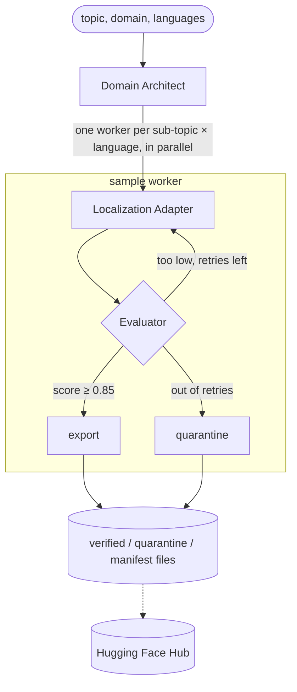

# PolyGlot-Crew

Generates synthetic NLP datasets (medical, legal, finance) in Indian languages, and only keeps the samples that pass review.

You give it a seed topic like "Clinical Drug Dosage Diagnostics" and a list of languages. Three LLM agents then do the work:

1. **Domain Architect** splits the topic into sub-topics. Each gets a short English source passage and a list of key entities (drug names, doses, statutes, amounts...).
2. **Localization Adapter** rewrites each passage for native readers of Hindi, Hinglish, Telugu, Tamil and so on. It adapts the text rather than translating word for word.
3. **Adversarial Evaluator** reviews every draft. A rejected draft goes back to the adapter with feedback, up to 3 times. If it still fails, it's quarantined, not published.

What passes ends up as JSONL with exact character spans for every entity, ready for NER training or for publishing on the Hugging Face Hub.

It's built on LangGraph and Pydantic v2. Each agent can run on the Claude API or on a local Ollama model, and you can mix the two.

## How it works



Some details worth knowing:

- **The LLM never gives character offsets.** Models can't count characters reliably, so the adapter returns entity strings only. `src/linguistics.py` then finds every occurrence in the NFC-normalised text and computes the spans, so `raw_text[start:end] == text` always holds. For Telugu, Tamil, Kannada and Malayalam a match may end mid-word, because case suffixes attach directly to the entity.
- **Cheap checks run before the LLM critic.** The evaluator first checks the script (e.g. at least 60% Devanagari for Hindi), that every tagged entity is really in the text, that the labels are valid, that the key entities survived, and that every number from the source is still there (`२५` counts as `25`). If any of these fail, the draft is rejected with a precise reason and no critic call is spent on it.
- **The critic's score can't hide a serious error.** It scores semantic fidelity, factual consistency, entity retention and fluency. The final score is a weighted mean, but if any one dimension is below 0.6, the score is capped at that dimension. Great fluency doesn't make up for a changed dose.
- **One failing sample doesn't sink the batch.** If a provider call fails for one sample, that sample is quarantined with `reason: pipeline_error` and the others carry on.

## Project layout

```
main.py                  CLI: run a batch, print the report, write the files
scripts/publish_to_hub.py  publish all verified batches as one HF dataset
src/
  config.py              settings from .env, per-role model choice, quality gate
  llm.py                 Claude/Ollama wrapper: structured output, retries, token logging
  linguistics.py         NFC, script detection, number matching, entity span alignment
  graph.py               the two LangGraph graphs (fan-out + retry loop)
  exporter.py            JSONL/manifest writer, HF dataset folder + card, upload
  telemetry.py           token and latency counters
  agents/
    nodes.py             the three agents and the export/quarantine steps
    prompts.py           prompt templates
    state.py             graph state
  schemas/
    dataset.py           published record types and entity label sets
    agent_io.py          what each LLM must return
    languages.py         supported languages and their style guides
tests/                   offline tests with a fake LLM
```

## Setup

Needs Python 3.11 or newer.

```bash
git clone <your-fork-url> polyglot-crew && cd polyglot-crew
python3.12 -m venv .venv && source .venv/bin/activate
pip install -r requirements.txt
cp .env.example .env
```

## Running

### With Ollama (free, runs locally)

```bash
ollama pull llama3     # or mistral, qwen2.5, gemma3...
ollama serve           # if it isn't running already

# in .env
LLM_PROVIDER=ollama
OLLAMA_MODEL=llama3
MAX_CONCURRENCY=1      # keep it at 1-2 on a single GPU

python main.py --seed-topic "Clinical Drug Dosage Diagnostics" --languages hindi hinglish telugu
```

Small 7–8B models are weak at Indian languages. They often tag words that aren't in their own output, and as judges they tend to be too lenient. Expect a lot of quarantined samples. For a better yield, generate locally and judge with a stronger model (see below).

### With the Claude API

```bash
# in .env
LLM_PROVIDER=anthropic
ANTHROPIC_API_KEY=sk-ant-...
ANTHROPIC_MODEL=claude-sonnet-5-5
MAX_CONCURRENCY=6

python main.py --domain medical --num-subtopics 5 --languages hindi hinglish telugu tamil
```

### Mixing models per role

Each role can have its own `provider:model`. Using a different model as the judge also helps against a model going easy on its own writing.

```bash
LLM_PROVIDER=ollama
OLLAMA_MODEL=llama3
EVALUATOR_LLM=anthropic:claude-sonnet-5-5
ANTHROPIC_API_KEY=sk-ant-...
```

### CLI

```text
python main.py [--seed-topic TEXT] [--domain {medical,legal,finance}]
               [--languages LANG [LANG ...]] [--num-subtopics N]
               [--provider {anthropic,ollama}] [--max-concurrency N]
               [--output-dir DIR] [--env-file PATH]
               [--push-to-hub [REPO_ID]] [--log-level LEVEL]
```

Languages can be given by name or code: `hindi` (`hi`), `hinglish` (`hi-Latn`), `marathi`, `bengali`, `gujarati`, `punjabi`, `telugu`, `tamil`, `kannada`, `malayalam`.

Exit codes: 0 success, 1 bad config or input, 2 pipeline failure (e.g. provider unreachable), 130 interrupted.

### What a run looks like

Every LLM call is logged with tokens and time, and you get a report at the end. This is from a real local run with `llama3`:

```text
[localizer] ollama:llama3 | hi | Optimizing Antihypertensive Therapy | attempt 1 | 517 in / 296 out tokens | 14.27s
[evaluator] ollama:llama3 | hi | Optimizing Antihypertensive Therapy | attempt 1 | 680 in / 255 out tokens | 13.49s
[evaluator] hi | Optimizing Antihypertensive Therapy | attempt 1 | score 0.830 (ollama:llama3)
[localizer] ollama:llama3 | hi | Optimizing Antihypertensive Therapy | attempt 2 | 939 in / 286 out tokens | 15.35s
...
==============================================================================
 PolyGlot-Crew run report  |  batch batch-8c27a998ac57
==============================================================================
 Seed topic : Clinical Drug Dosage Diagnostics  (medical)
 Samples    : 4 planned | 3 verified | 1 quarantined {'low_quality': 1}
 Acceptance : 75.0% overall | 25.0% first-pass | 1.0 mean retries (verified)
 Throughput : 212.06s wall | 1.13 samples/min
 LLM usage  : 16 calls (0 failed) | 10,427 in + 4,182 out tokens | 212.0s model time

 Usage by role:
     role         model  calls  failed  input_tokens  output_tokens  mean_latency_s  p95_latency_s
architect ollama:llama3      1       0           251            378           17.28          17.28
localizer ollama:llama3     10       0          6824           2408           12.18          15.07
evaluator ollama:llama3      5       0          3352           1396           14.58          21.95

 Quality by language:
language  samples  mean_score  min_score  mean_retries  mean_entities
      hi        2        0.85       0.85           0.5            4.5
 hi-Latn        1        0.87       0.87           2.0            4.0
```

The 10 localizer calls needed only 5 critic calls: the rule checks threw out the other 5 drafts before the critic saw them. One was a Hinglish draft that dropped the "3" from "3 times a day".

### Output files

```
data/
├── verified/<batch_id>.jsonl     samples that passed
├── quarantine/<batch_id>.jsonl   rejected drafts with all the feedback they got
└── manifests/<batch_id>.json     batch info + the run report
```

A verified record (shortened; this one needed one retry):

```json
{
  "id": "pg-…",
  "target_language": "hi",
  "script": "Deva",
  "raw_text": "डॉक्टर ने आपके लिए मेटोप्रोलोल निर्धारित किया है … आपको 50mg दो बार दिन में लेना होगा अगले 4 हफ्तों के लिए …",
  "entities": [
    {"text": "मेटोप्रोलोल", "label": "DRUG", "start_char": 19, "end_char": 30},
    {"text": "50mg", "label": "DOSAGE", "start_char": 99, "end_char": 103},
    {"text": "दो बार दिन में", "label": "FREQUENCY", "start_char": 104, "end_char": 118},
    {"text": "4 हफ्तों के लिए", "label": "DURATION", "start_char": 134, "end_char": 149}
  ],
  "domain": "medical",
  "quality_score": 0.85,
  "feedback": "…critic remarks…",
  "quality_breakdown": {"semantic_fidelity": 0.8, "factual_consistency": 0.9, "entity_retention": 0.9,
                        "fluency": 0.8, "entity_coverage": 1.0, "script_ratio": 0.992},
  "provenance": {"seed_topic": "Clinical Drug Dosage Diagnostics", "subtopic": "Optimizing Antihypertensive Therapy",
                 "text_format": "patient counselling dialogue", "source_context": "…English source…",
                 "generator_model": "ollama:llama3", "evaluator_model": "ollama:llama3",
                 "retry_count": 1, "created_at": "2026-10-21T08:41:46Z"}
}
```

## Data format

The record types are in `src/schemas/dataset.py`. They're strict, so a bad record can't be created in the first place:

- `EntityLabel`: `text`, `label`, `start_char`, `end_char`. The span length must equal `len(text)`.
- `SyntheticSample`: the published record. `raw_text` must be NFC, every span must match the text exactly, spans can't overlap, and labels must belong to the domain.
- `DatasetBatch`: one run's samples. `total_samples` must match, and ids must be unique.
- `QuarantinedSample`: a rejected draft. Loosely typed so it can always be saved.

Entity labels per domain:

- **medical**: DRUG, DOSAGE, FREQUENCY, ROUTE, DURATION, CONDITION, SYMPTOM, LAB_TEST, BODY_PART, PROCEDURE, POPULATION
- **legal**: STATUTE, PROVISION, COURT, PARTY, LEGAL_ROLE, JURISDICTION, DATE, PENALTY, LEGAL_CONCEPT, CASE_REFERENCE, AUTHORITY
- **finance**: ORGANIZATION, FINANCIAL_INSTRUMENT, MONETARY_AMOUNT, PERCENTAGE, DATE, REGULATOR, FINANCIAL_METRIC, TAX_CONCEPT, ACCOUNT_TYPE, MARKET_INDEX

## Publishing to Hugging Face

1. Create a write token at <https://huggingface.co/settings/tokens> and put it in `.env` as `HF_TOKEN`, or run `hf auth login`.
2. Publish straight after a run, or later:

```bash
python main.py --push-to-hub your-username/polyglot-medical-indic

# merge every batch in data/verified/ into one dataset
python scripts/publish_to_hub.py --repo-id your-username/polyglot-medical-indic
python scripts/publish_to_hub.py --dry-run    # just build data/hf_dataset/ so you can look at it first
```

Every record is validated again before upload and duplicate ids are dropped. The upload looks like this:

```
hf_dataset/
├── README.md                 dataset card (metadata, one config per language, stats, limitations)
└── data/<lang>/train.jsonl   e.g. data/hi/, data/hi-Latn/, data/te/
```

Each publish replaces what's on the Hub, so old files get removed. Repos are private unless you set `HF_PRIVATE=false` or pass `--public`. Loading the data:

```python
from datasets import load_dataset

ds = load_dataset("your-username/polyglot-medical-indic", "all")   # every language
te = load_dataset("your-username/polyglot-medical-indic", "te")    # just Telugu
```

## Configuration

All the options are in `.env.example` with comments. The ones you're most likely to change:

| Variable | Default | What it does |
|---|---|---|
| `LLM_PROVIDER` | `ollama` | Default backend for every agent (`ollama` or `anthropic`) |
| `ANTHROPIC_MODEL` / `OLLAMA_MODEL` | `claude-sonnet-5-5` / `llama3` | Model for each provider |
| `ARCHITECT_LLM`, `LOCALIZER_LLM`, `EVALUATOR_LLM` | empty | Use a different `provider:model` for one role |
| `*_TEMPERATURE` | 0.7 / 0.6 / 0.0 | Temperature per role; empty means the provider default |
| `QUALITY_THRESHOLD` | `0.85` | Minimum score to publish |
| `MAX_RETRIES` | `3` | Fix attempts before a sample is quarantined |
| `DIMENSION_FLOOR` | `0.6` | Any rubric score below this caps the final score |
| `MIN_ENTITY_COVERAGE` | `0.6` | Share of key entities that must survive |
| `LLM_MAX_ATTEMPTS` | `3` | Tries per LLM call (network errors, invalid output) |
| `MAX_CONCURRENCY` | `2` | Samples processed in parallel |
| `OLLAMA_NUM_CTX` | `8192` | Context window to ask Ollama for |

Settings are checked at startup. A missing `ANTHROPIC_API_KEY` or a malformed `EVALUATOR_LLM`, for example, stops the run right away with a clear message.

## Tests

```bash
pytest -q
```

All 45 tests run offline. The agents only depend on the small `StructuredGenerator` interface, so the tests plug in a fake LLM with scripted answers and run the real LangGraph graph. They cover the schema rules, span alignment (NFC, repeats, nested entities, suffixes, word boundaries), number matching, the export / retry / quarantine paths, rule checks that skip the critic, error isolation, fan-out, and the JSONL and Hugging Face export.

## Extending it

- **New language:** add a `LanguageSpec` in `src/schemas/languages.py` (code, script, style guide, `min_script_ratio`, `strict_right_boundary`). If it uses a script we don't have yet, add its Unicode range to `SCRIPT_RANGES` in `src/linguistics.py`.
- **New domain:** add it to `Domain`, give it labels in `DOMAIN_ENTITY_LABELS`, and add document formats to `TEXT_FORMATS` in `src/agents/prompts.py`.
- **New provider:** add a branch to `build_chat_model` in `src/llm.py`. Any LangChain chat model with `with_structured_output` should work.

## Limitations

- This is synthetic data. The checks catch a lot, but not everything, and the LLM critic is only as good as the model behind it. Read through a sample of the output yourself, and test anything you train on it against human-labelled data.
- The medical, legal and financial content isn't professional advice. The generated dataset card says so too.
- Entity spans are always exact, but whether the label is right is still the model's call. The rules and the critic check it, but they can miss things.
